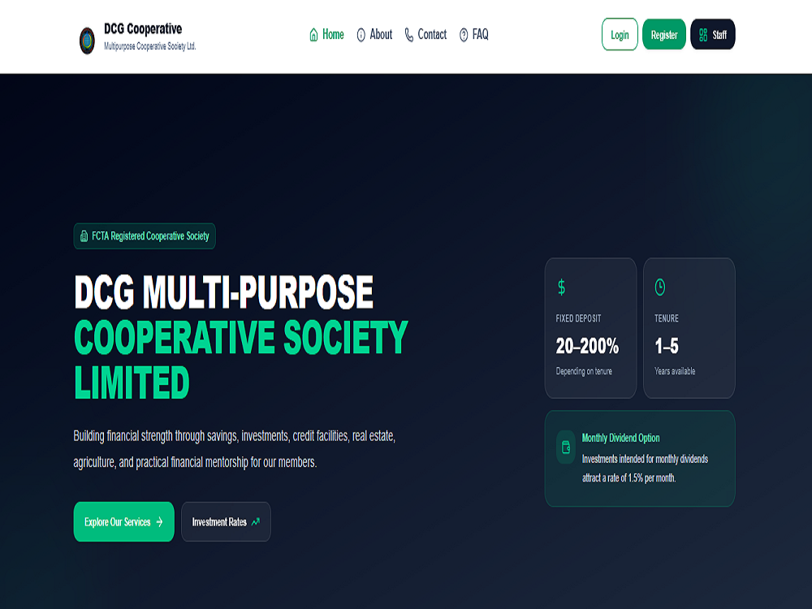
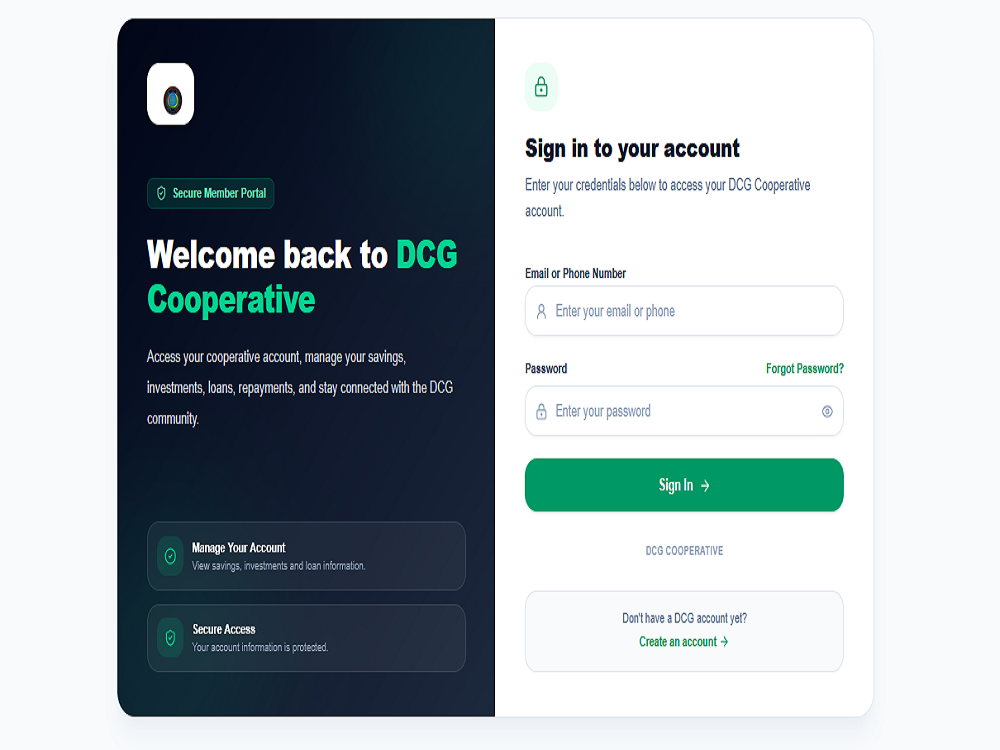

# Loan Management System Using Next.js

A modern web-based loan management system designed to help manage cooperative society operations, member accounts, loan applications, repayments, savings, fixed deposits, and administrative workflows.

**GitHub Repository:** [Loan-management-system-using-Next.js](https://github.com/emmy-tech247/Loan-management-system-using-Next.js/tree/main)

## Screenshots

### 1. Homepage



### 2. Admin Dashboard


### 3. Login Page



## About the Project

The Loan Management System is a full-stack web application built to support the digitization of cooperative financial services. It aims to simplify loan processing, improve member record management, streamline staff operations, and provide a centralized platform for managing financial activities.

The project is developed using Next.js and TypeScript, with database integration for storing and retrieving application data.

## Technology Stack

- **Frontend:** Next.js, React, TypeScript
- **Styling:** Tailwind CSS
- **Backend:** Next.js API routes
- **Database:** MySQL
- **ORM:** Prisma
- **Version Control:** Git and GitHub
- **Deployment:** Vercel

## Key Features

The system is designed to support the following functionality, depending on the modules implemented in the current version:

- **Member Management:** Maintain member records and account information.
- **Loan Applications:** Support loan application submission and processing workflows.
- **Loan Repayments:** Manage repayment records and transaction tracking.
- **Savings Management:** Track member savings and related account activities.
- **Fixed Deposits:** Support fixed-deposit account management and related transactions.
- **Staff and Administration:** Provide role-based operational workflows for authorized personnel.
- **Financial Reporting:** Support access to loan and transaction information for monitoring and reporting.
- **Authentication and Access Control:** Organize access to protected application areas.
- **Responsive Interface:** Provide a user interface suitable for desktop and mobile screens.

## Project Architecture

The application uses Next.js for the web interface and server-side functionality, TypeScript for type safety, and MySQL for relational data storage. Prisma is used for database access where configured.

## Getting Started

### Prerequisites

Install the following before running the project:

- Node.js 20.9 or later
- npm
- MySQL Server
- Git

### 1. Clone the repository

```bash
git clone https://github.com/emmy-tech247/Loan-management-system-using-Next.js.git
```

### 2. Enter the project directory

```bash
cd Loan-management-system-using-Next.js
```

### 3. Install dependencies

```bash
npm install
```

### 4. Configure environment variables

Create a `.env` file in the project root and configure the database and any other environment variables required by the application.

Example MySQL configuration:

```env
DB_HOST=localhost
DB_PORT=3306
DB_USER=your_mysql_username
DB_PASSWORD=your_mysql_password
DB_NAME=your_database_name
```

Use the exact variable names expected by your project's database configuration. If your Prisma setup requires a database URL or additional adapter settings, configure those as well.

**Security:** Never commit real database passwords, API keys, or production secrets to GitHub.

### 5. Configure the database

Create the required MySQL database and configure Prisma according to the project's existing schema and database setup. If migrations are configured, run the appropriate migration command for the project.

### 6. Start the development server

```bash
npm run dev
```

Open [http://localhost:3000](http://localhost:3000) in your browser.

### 7. Build for production

```bash
npm run build
```

## Deployment

The application can be deployed to Vercel after configuring the repository, build settings, environment variables, and database connectivity.

For production deployment, ensure that the database is accessible from the hosting environment and that all required secrets are configured securely.

## Future Improvements

Potential improvements include enhanced financial dashboards, automated repayment reminders, audit trails, downloadable reports, and expanded transaction monitoring.

## Author

**Emmanuel James Alao**

Full-Stack Developer

- **GitHub:** [@emmy-tech247](https://github.com/emmy-tech247)
- **Portfolio:** [emmanuel-alao-portfolio.vercel.app](https://emmanuel-alao-portfolio.vercel.app)

## License

A license has not yet been specified. Add a `LICENSE` file if you intend to distribute the project under an open-source license.
